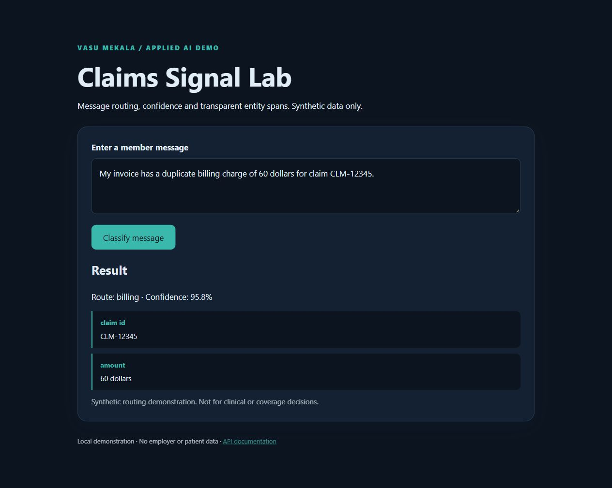
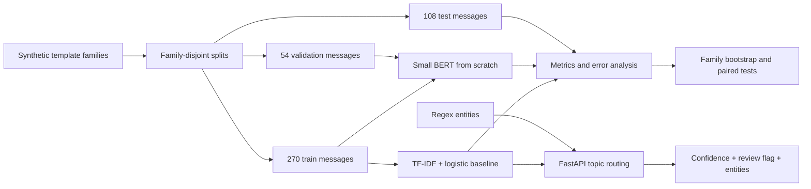

# Claims Signal Lab

**Route synthetic member messages, compare a baseline with BERT, and make the errors visible.**

[](https://github.com/vasum-111/healthcare-claims-nlp/actions/workflows/ci.yml)




## Problem and scope

Member messages mix clinical questions, billing issues and coverage-eligibility questions.
This project classifies the **message topic** for human review. It makes no decision about
health, treatment, coverage or benefits.

This is a new November 2026 demonstration of techniques named in my resume, using
**432 generated messages and no patient data**. It is not employer software, a clinical
validation study or evidence of historical employer-scale outcomes.

The web demo serves TF-IDF + logistic regression because it performed better. The comparison
uses Hugging Face `BertForSequenceClassification` with two small layers, **random initialization**
and a vocabulary learned from training text only. It is not pretrained BERT or a clinical
foundation model. Entity extraction uses explicit regex rules for claim IDs, dates,
diagnosis-code-shaped tokens and amounts; it is not trained medical NER or clinical-code validation.

## Architecture



All variants of a template stay in the same split: **15 train, 3 validation and 6 test families**.
Test text never fits the vectorizer/vocabulary. Validation loss selects the BERT checkpoint.
Families still share vocabulary and form a tiny artificial sample, so this split does not
establish real-world generalization.

## Baseline and demo

Use Python 3.12. From this repository:

```sh
python -m venv .venv
# Windows PowerShell: .\.venv\Scripts\Activate.ps1
# macOS/Linux: source .venv/bin/activate
python -m pip install -r requirements-dev.txt
python -m src.data
python -m pytest -q
python -m src.evaluate
python -m uvicorn src.api:app --host 127.0.0.1 --port 8000
```

Open http://127.0.0.1:8000. The response contains a topic, model confidence, review flag and
entities. `/docs` documents the API. Messages are processed in memory without a message database.

```powershell
Invoke-RestMethod http://127.0.0.1:8000/classify -Method Post -ContentType application/json -Body '{"text":"My invoice includes a duplicate charge of 60 dollars."}'
```

The baseline evaluation overwrites `reports/evaluation.json` with a baseline-only report.
Run the full comparison below to regenerate both models' measurements.

## BERT comparison

```sh
python -m pip install torch==2.15.0 --index-url https://download.pytorch.org/whl/cpu
python -m pip install -r requirements-bert.txt
python -m pytest -q
python -m src.evaluate --bert --epochs 35
```

CPU training needs no pretrained-model download or API key. Dependencies need internet access.
Weights/configuration/vocabulary go to ignored `artifacts/bert/`. The recorded run used seed 42,
90,755 parameters and 172
vocabulary entries. Validation selected epoch 4 of 35.
Results may vary slightly across runtimes.

## Measured results — 13 November 2026

| Model | Test accuracy | Macro F1 | Family-bootstrap 95% interval |
| --- | ---: | ---: | --- |
| TF-IDF + logistic regression | 0.991 | 0.991 | 0.981–1.000 |
| Small BERT, random initialization | 0.620 | 0.593 | 0.457–0.734 |

There are 36 test messages per class. The high baseline score reflects simple synthetic
templates and must not be presented as patient-data performance. BERT underperforms,
particularly on clinical messages. The demo therefore uses the baseline.

| Class | Baseline precision / recall / F1 | BERT precision / recall / F1 |
| --- | --- | --- |
| billing | 0.973 / 1.000 / 0.986 | 0.474 / 0.750 / 0.581 |
| clinical | 1.000 / 0.972 / 0.986 | 0.353 / 0.167 / 0.226 |
| eligibility | 1.000 / 1.000 / 1.000 | 1.000 / 0.944 / 0.971 |

### Statistical interpretation

The report uses 600 label-stratified family-bootstrap resamples. Only two held-out families
per class means these intervals reflect a very limited synthetic design.
A two-sided sign-permutation comparison across six family accuracy differences gives
**p = 0.125**. It does not establish a difference
at 0.05 with this small family sample.

For teaching contrast, exact message-level McNemar p =
1.82e-12 is also recorded. Correlated template variants
violate independence, so that smaller p-value must **not** support a strong significance claim.
Neither analysis supports a clinical or business-impact claim.

### Error examples

| Held-out message | Correct topic | BERT prediction |
| --- | --- | --- |
| Question: The hospital discharge note recommends a follow-up care visit. | clinical | billing |
| Question: The hospital discharge note recommends a follow-up care visit. | clinical | billing |
| The hospital discharge note recommends a follow-up care visit. | clinical | billing |

[Full report](reports/evaluation.json) includes confusion matrices, all test predictions,
validation-loss history and dataset hash. Validation loss rises after early epochs,
consistent with overfitting this small training set.

## Tests, notebook and container

**Six tests passed locally** with BERT dependencies. Base-only CI runs five and skips the
optional BERT tokenizer test. Tests cover split isolation, deterministic generation,
train-only vocabulary fitting, entity offsets, API limits and unknown/padding tokens.
Notebook code cells were executed against the implementation.

```sh
docker build -t claims-signal-lab .
docker run --rm -p 8000:8000 claims-signal-lab
```

The image serves the baseline; BERT is an explicit experiment.
[GitHub Actions passed the tests and Docker image build](https://github.com/vasum-111/healthcare-claims-nlp/actions/runs/43530979089) on 13 November 2026.
Container startup has not been tested in Docker; the API and browser flow were verified locally.
The manual BERT workflow is available but has not been dispatched; the recorded BERT experiment ran locally.

## Limits and next experiments

- The 0.60 review threshold is a demo policy, not a calibrated clinical threshold.
- Model confidence is not a validated probability of correct routing.
- Add independently authored template families and a locked test set before optimizing.
- Compare licensed pretrained BERT with this baseline under the same split rules.
- Add unknown-topic detection, probability calibration and entity-span evaluation.
- Add human review, access controls and retention policies before real use.

## Repository map

```text
src/           data, baseline, BERT, entities, evaluation and API
data/          generated messages with family/split IDs
tests/         split, vocabulary, entity, API and tokenizer tests
notebooks/     short walkthrough
web/           responsive demo
reports/       measured results and reproduction manifest
docs/          screenshot, provenance and future commit plan
```

[Provenance](docs/PROVENANCE.md) · [Future commit plan](docs/COMMIT-PLAN.md) · [MIT](LICENSE)
